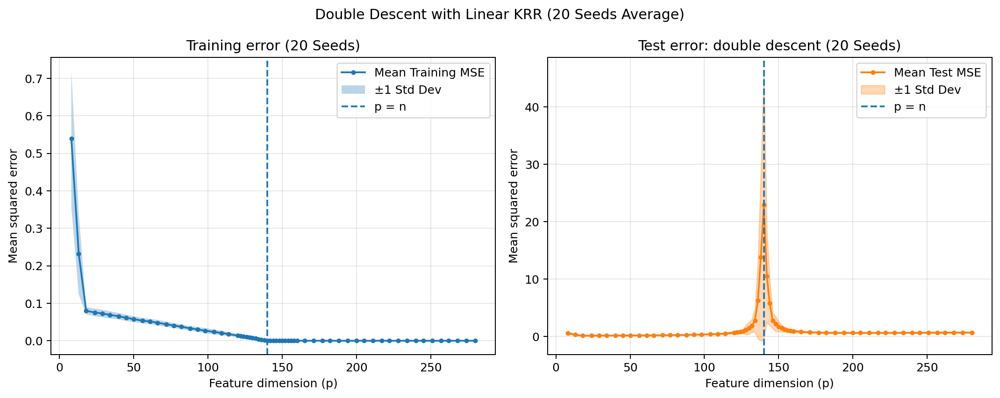
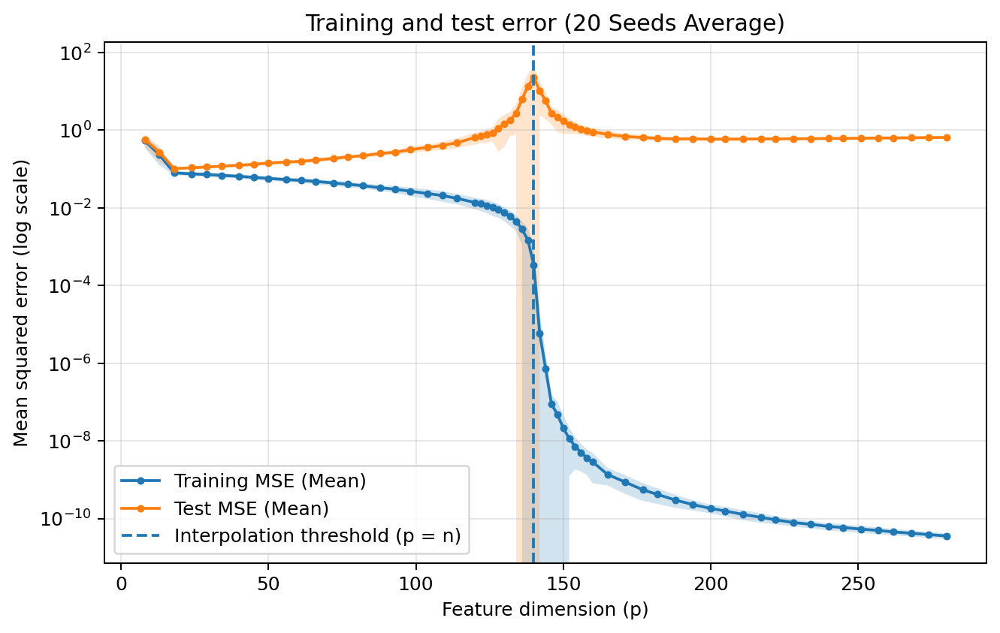

# Double Descent in Kernel Ridge Regression

A synthetic experiment showing double descent in linear-kernel KRR,
averaged over 20 random seeds.

## Setup
- n = 140 training samples, 1200 test samples
- 15 signal features, noise std 0.30, ridge lambda = 1e-3
- Feature dimension p swept from 8 to 280

## Run
```
pip install -r requirements.txt
python3 double_descent_krr_20seed.py
```

## Results
Mean test MSE peaks at p = n = 140 (about 22.9), then drops again
as p grows, which is the double descent.
Mean test MSE peaks at p = n = 140 (about 22.9), then drops again
as p grows, which is the double descent.

Training error drops to near zero once p ≥ n, because the model can interpolate the data. Test error spikes at p = n, where the kernel matrix is nearly singular, then falls again as p grows.



